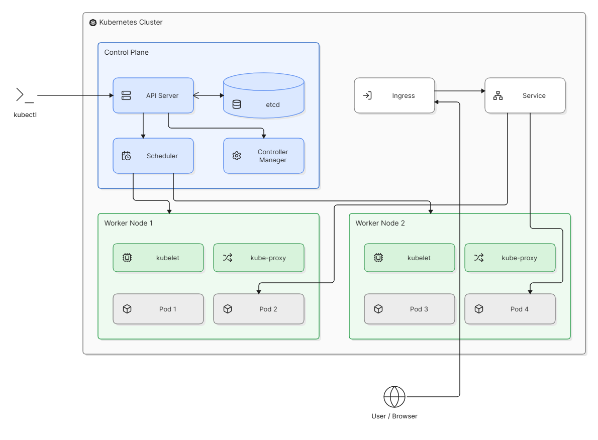

# Architecture Kubernetes

Kubernetes repose sur deux grandes parties :
le Control Plane et les Worker Nodes.

## Schéma de l'architecture

## Le Control Plane

Il pilote et supervise le cluster.

## Les Worker Nodes

Ils hébergent les Pods qui exécutent les applications.